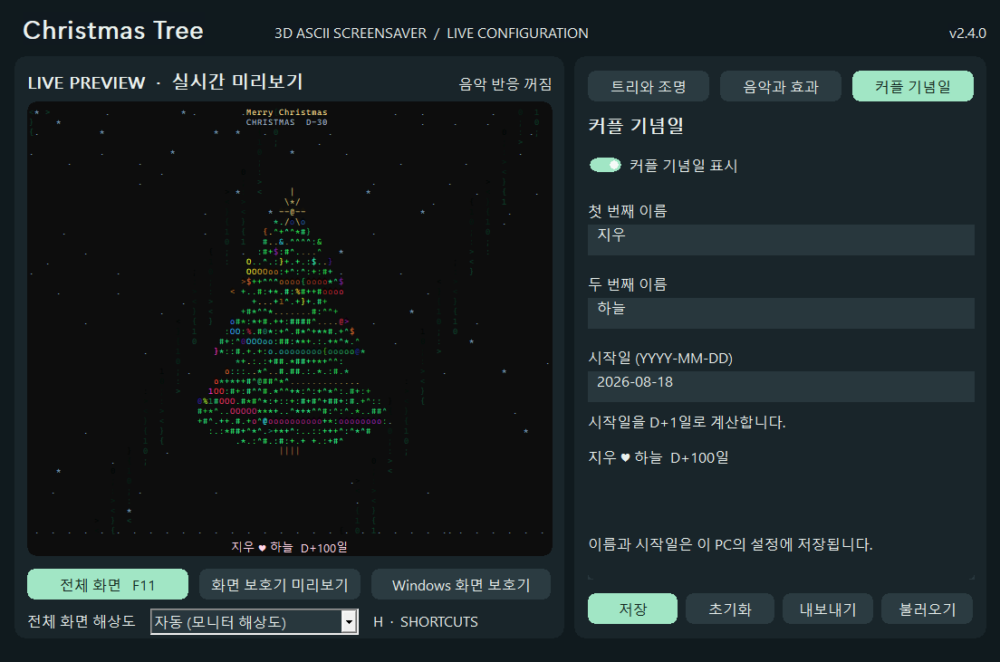
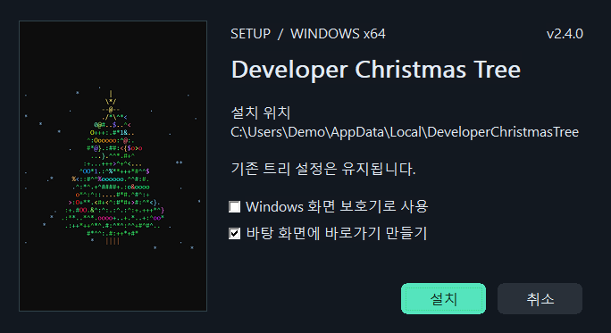

# 🎄 Developer Christmas Tree

Windows용 3D ASCII 크리스마스 트리입니다. 색과 회전, 눈, 코드 장식을 바꾸고, v2에서는 시스템 음악에 반응하는 트리를 전체 화면이나 화면 보호기로 즐길 수 있습니다.

**Windows 10/11 x64 대상 · 최신 정식 릴리스 v2.4.0**

[v2.4.0 설치기 다운로드](https://github.com/cheld536/-dev-Christmas-tree/releases/download/v2.4.0/DeveloperChristmasTree_v2.4_Setup.exe) · [릴리스 및 SHA256 검사값](https://github.com/cheld536/-dev-Christmas-tree/releases/tag/v2.4.0)

### 커플 기념일 (v2.4)

1. 설정 창 오른쪽 위의 **커플 기념일** 탭을 엽니다.
2. 두 이름과 시작일을 `YYYY-MM-DD` 형식으로 입력하고 **커플 기념일 표시**를 켭니다.
3. **저장**을 누릅니다. 미리보기와 F11 전체 화면의 트리 아래에 `지우 ♥️ 하늘  D+100일`과 같은 형식으로 표시됩니다.

시작일은 `D+1일`입니다. 카운터를 끄면 개발자 문구가 다시 표시됩니다. 이름과 날짜는 이 PC의 앱 설정에 저장하며, 시각 프리셋 내보내기에서는 제외합니다.

v2.4.1 개발 빌드에서는 시작일 옆 **달력에서 선택**을 누르고 날짜를 고를 수 있습니다. 키보드로는 방향키로 이동하고 **Enter**로 선택하거나 **Esc**로 닫습니다.

<details>
<summary>v2.4.1 달력 선택 화면</summary>


</details>



### 전체 화면 해상도

**LIVE PREVIEW** 아래의 **전체 화면 해상도**에서 **자동**, **1080p (1920×1080)**, **4K (3840×2160)**를 선택한 뒤 **저장**을 누릅니다. F11로 열리는 화면에 적용됩니다. 다른 화면 비율에서는 원본 비율을 유지하도록 여백이 생깁니다. Windows 디스플레이 모드는 현재 값으로 유지됩니다.

| 시작 방법 | 필요한 것 |
| --- | --- |
| [EXE로 설치하기](#exe로-설치하기) | v2 설치 파일과 Windows. Python과 Go 설치 없이 실행할 수 있습니다. |
| [Python 소스로 실행하기](#python-소스로-실행하기) | Tcl/Tk가 포함된 Python 3.13과 이 저장소의 소스 |

## EXE로 설치하기

1. [v2.4.0 릴리스](https://github.com/cheld536/-dev-Christmas-tree/releases/tag/v2.4.0)의 **Assets**에서 **`DeveloperChristmasTree_v2.4_Setup.exe`**를 내려받습니다. 기존 트리 창이 열려 있으면 먼저 닫습니다.
2. 설치 파일을 두 번 클릭합니다. **바탕 화면에 바로가기 만들기**는 기본으로 선택되어 있습니다. 화면 보호기도 등록하려면 **Windows 화면 보호기로 사용**을 선택한 뒤 **설치**를 누릅니다.
3. 설치가 끝나면 **실행**을 누릅니다. 이후에는 시작 메뉴나 바탕 화면에서 **Developer Christmas Tree**를 엽니다.
4. 테마·회전·음악 반응을 조절하고 **저장**을 누릅니다. **F11**로 일반 전체 화면을 열고 **Esc** 또는 **F11**로 돌아갑니다. **화면 보호기 미리보기**로 화면 보호기 동작을 확인할 수 있습니다.



음악에 반응하는 조명과 주파수 막대를 사용하려면 [음악과 효과 설정](#음악과-효과-설정)을 확인하세요.

**화면 보호기 변경**은 앱의 **Windows 화면 보호기** 버튼에서 할 수 있습니다. 잠금이 필요하면 Windows 화면 보호기 설정에서 로그온 화면 표시를 선택합니다. **제거**는 Windows의 **설정 → 앱 → 설치된 앱 → Developer Christmas Tree**에서 진행합니다. 저장한 설정을 지울지 선택할 수 있습니다.

### 버전별 다운로드

| 버전 | EXE 바로 받기 | 실행 방식 |
| --- | --- | --- |
| [v2.4.0](https://github.com/cheld536/-dev-Christmas-tree/releases/tag/v2.4.0) | [DeveloperChristmasTree_v2.4_Setup.exe](https://github.com/cheld536/-dev-Christmas-tree/releases/download/v2.4.0/DeveloperChristmasTree_v2.4_Setup.exe) | Windows 설치 |
| [v2.3.0](https://github.com/cheld536/-dev-Christmas-tree/releases/tag/v2.3.0) | [DeveloperChristmasTree_v2.3_Setup.exe](https://github.com/cheld536/-dev-Christmas-tree/releases/download/v2.3.0/DeveloperChristmasTree_v2.3_Setup.exe) | Windows 설치 |
| [v2.2.0](https://github.com/cheld536/-dev-Christmas-tree/releases/tag/v2.2.0) | [DeveloperChristmasTree_v2.2_Setup.exe](https://github.com/cheld536/-dev-Christmas-tree/releases/download/v2.2.0/DeveloperChristmasTree_v2.2_Setup.exe) | Windows 설치 |
| [v2.1.0](https://github.com/cheld536/-dev-Christmas-tree/releases/tag/v2.1.0) | [DeveloperChristmasTree_v2.1_Setup.exe](https://github.com/cheld536/-dev-Christmas-tree/releases/download/v2.1.0/DeveloperChristmasTree_v2.1_Setup.exe) | Windows 설치 |
| [v2.0.0](https://github.com/cheld536/-dev-Christmas-tree/releases/tag/v2.0.0) | [DeveloperChristmasTree_v2.0_Setup.exe](https://github.com/cheld536/-dev-Christmas-tree/releases/download/v2.0.0/DeveloperChristmasTree_v2.0_Setup.exe) | Windows 설치 |
| [v1.0.0](https://github.com/cheld536/-dev-Christmas-tree/releases/tag/v1.0.0) | [DeveloperChristmasTree_v1.0.exe](https://github.com/cheld536/-dev-Christmas-tree/releases/download/v1.0.0/DeveloperChristmasTree_v1.0.exe) | 두 번 클릭하면 Python/Tkinter 설정 창이 열립니다. |

<details>
<summary>다운로드한 파일의 SHA256 확인</summary>

검사할 EXE와 같은 버전의 `SHA256SUMS.txt`를 같은 폴더로 내려받습니다. 그 폴더에서 PowerShell을 열고 두 명령이 출력하는 64자리 검사값을 비교합니다. 아래 예시는 v2.4.0 기준입니다.

```powershell
Get-FileHash -Algorithm SHA256 .\DeveloperChristmasTree_v2.4_Setup.exe
Get-Content .\v2.4.0-SHA256SUMS.txt
```

</details>

## 음악과 효과 설정

1. 설정 창 오른쪽 위 **음악과 효과** 탭을 열고 **음악 반응**을 켭니다.
2. PC에서 음악을 재생합니다. **음악 스타일**과 **반응 강도**를 바꾸면 트리 조명의 반응이 달라집니다. 저음·중음·고음을 따로 조절하려면 음악 스타일에서 **직접 설정**을 선택합니다.
3. **이퀄라이저**를 켜면 미리보기 아래에 주파수 막대가 나타납니다. **BPM 표시**는 선택 사항입니다. 다음 실행에도 설정을 적용하려면 **저장**을 누릅니다.

전체 화면에서는 **A**로 음악 반응, **P**로 음악 프리셋, **V**로 이퀄라이저를 조절합니다. 오디오 반응은 Windows 시스템 소리를 사용합니다. 곡명·아티스트·진행률·앨범 커버는 재생 앱이 Windows에 제공할 때 표시됩니다.


## Python 소스로 실행하기

Python/Tkinter로 만든 v1 설정 앱과 원본 터미널 트리는 소스에서 바로 실행할 수 있습니다. Windows PowerShell에서 `py -3.13 -m tkinter`를 실행해 Tk 테스트 창이 열리는지 확인하고 창을 닫습니다.

```powershell
git clone https://github.com/cheld536/-dev-Christmas-tree.git developer-christmas-tree
Set-Location .\developer-christmas-tree\legacy\python
py -3.13 .\christmas_screensaver.py
```

Git 없이 받은 소스 ZIP을 압축 해제했다면 그 폴더의 `legacy\python`에서 마지막 명령을 실행합니다. 설정 창에서 미리보기를 보며 색상·조명·회전을 조절하고 **설정 저장**을 눌러 다음 실행에 적용합니다.

| 실행 모드 | PowerShell 명령 |
| --- | --- |
| Tkinter 설정 창과 실시간 미리보기 | `py -3.13 .\christmas_screensaver.py` |
| 화면 보호기 전체 화면 | `py -3.13 .\christmas_screensaver.py /s` |
| 터미널에서 3D ASCII 애니메이션 | `py -3.13 .\terminal_tree.py` |
| 터미널에 한 프레임만 출력 | `py -3.13 .\terminal_tree.py --preview --no-color` |

Python 전체 화면은 키나 마우스 입력으로 닫을 수 있습니다. 터미널 애니메이션은 **Ctrl+C**로 종료합니다.

### 터미널 실행 화면


### Tkinter 설정 창


## v2 단축키

일반 전체 화면에서 **H**를 누르면 단축키 패널이 열립니다.

| 키 | 기능 |
| --- | --- |
| F11 / Esc | 돌아가기 |
| Space | 회전 일시 정지 / 재개 |
| ↑ / ↓ | 회전 속도 |
| ← / → | 회전 방향 |
| C / D | 색상 / 코드 스타일 |
| A / P | 음악 반응 / 음악 프리셋 |
| S / M | 눈 / 코드 비 |
| B / V | 빛 번짐 / 이퀄라이저 |
| G / J | 음악 반응 강도 |
| Z / X / N | 이전 곡 / 재생·일시 정지 / 다음 곡 |
| Tab | 시스템 사용량 |
| H | 단축키 패널 |

미디어 키 동작은 재생 앱과 Windows 세션에 따라 달라집니다. 설정은 `%LOCALAPPDATA%\DeveloperChristmasTree\settings.json`에 저장됩니다.

## 개발 및 빌드

Windows에서 Go 1.23 이상으로 아래 명령을 실행합니다. 외부 Go 모듈은 필요하지 않습니다.

```powershell
.\build.ps1
```

현재 개발 소스의 빌드 결과는 `dist/DeveloperChristmasTree_v2.4.1_Setup.exe`와 `dist/v2.4.1-SHA256SUMS.txt`입니다. 설치기는 먼저 빌드한 `setup/app.exe`를 포함합니다. Windows 아이콘 리소스는 빌드 시 생성됩니다. Python 테스트는 `legacy\python`에서 `py -3.13 -m unittest -v test_app`로 실행합니다.

개발 버전은 [VERSION](internal/buildinfo/VERSION)에서 관리합니다. 앱, 설치 창, 설치 정보, 기본 파일명과 검사값 파일명이 이 버전을 사용합니다. 릴리스 워크플로는 태그의 버전을 빌드에 전달합니다.

GitHub Actions는 `main` 푸시와 풀 리퀘스트에서 Go 및 Python 테스트와 Windows 빌드를 실행합니다. `main`에 포함된 커밋의 새 `vMAJOR.MINOR.PATCH` 태그를 푸시하면 해당 버전으로 설치기를 빌드하고, EXE와 검사값을 검증한 뒤 GitHub Release를 공개합니다.

주석 태그의 메시지는 릴리스 설명이 됩니다. `Release-Channel: prerelease` 줄을 넣으면 그 줄을 제외한 설명과 함께 프리릴리스로 공개합니다.

| 경로 | 역할 |
| --- | --- |
| `engine.go`, `audio.go` | 3D 투영·테마·효과, FFT·비트·오디오 반응 |
| `engine_test.go`, `audio_test.go` | 엔진·설정 및 합성 오디오 테스트 |
| `*_windows.go` | Win32 UI, GDI 렌더링, WASAPI 및 GSMTC |
| `setup/` | Windows 설치 및 제거 프로그램 |
| `legacy/python/` | Python/Tkinter 설정 앱과 터미널 트리 |

## 검증과 프로젝트 기록

Windows 11 x64와 Windows CI에서 설치·실행·제거를 확인했습니다. CI는 v2.2.0과 v2.3.0에서 v2.4.0으로 업그레이드할 때 기존 설정 유지, 화면 보호기 설정 복원, 커플 기념일 입력·저장·재실행을 검사합니다. Windows 10 실기, 네이티브 4K와 장시간 실행은 추가 검증 대상입니다. 배포 EXE는 서명되지 않았습니다. 음악 분석과 미디어 정보 조회는 PC에서 이루어집니다.

[변경 이력](CHANGELOG.md) · [커플 기념일 설계](docs/ROADMAP.md) · [아키텍처](docs/ARCHITECTURE.md) · [Windows QA](docs/WINDOWS_QA.md) · [이전 버전 SHA256](docs/release-checksums.txt)

Git 이력은 제공된 과거 소스 스냅샷을 바탕으로 재구성했습니다. 라이선스는 저장소 소유자가 결정하기 전까지 미지정 상태입니다.
