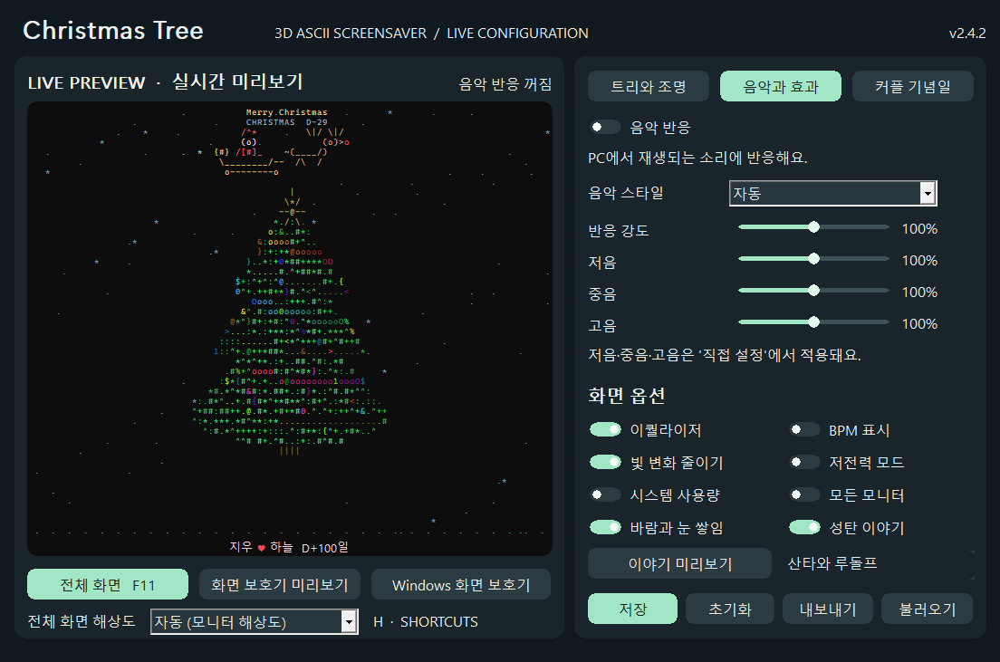
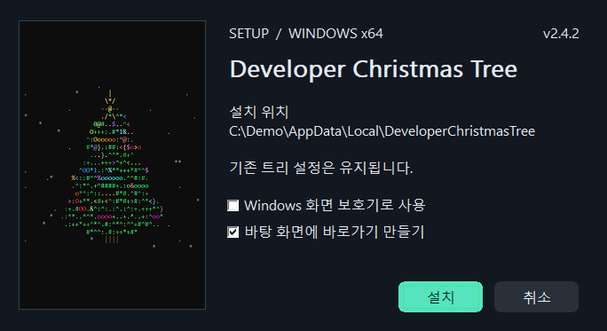
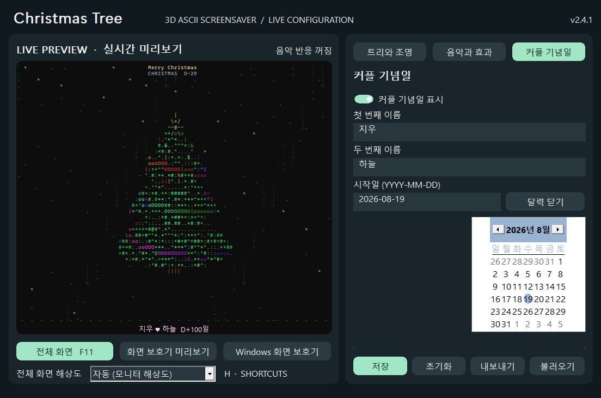
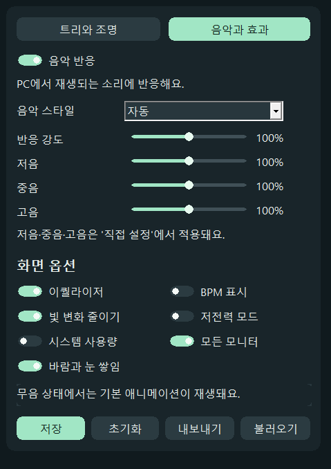

# 🎄 Developer Christmas Tree

Windows와 macOS용 3D ASCII 크리스마스 트리입니다. 음악에 반응하는 조명과 이퀄라이저, 산타와 루돌프가 등장하는 성탄 장면, 개발자 인사말과 커플 기념일을 즐길 수 있습니다.

## 운영체제별 다운로드

| 운영체제 | 버전 | 다운로드 |
| --- | --- | --- |
| **Windows 10/11 x64** | v2.4.3 정식 | [설치 EXE](https://github.com/cheld536/-dev-Christmas-tree/releases/download/v2.4.3/DeveloperChristmasTree_v2.4.3_Setup.exe) · [SHA256](https://github.com/cheld536/-dev-Christmas-tree/releases/download/v2.4.3/v2.4.3-SHA256SUMS.txt) |
| **Windows 10/11 x64** | v2.5.0 개발 | [최신 성공 빌드](https://github.com/cheld536/-dev-Christmas-tree/actions/workflows/windows.yml?query=branch%3Amain+is%3Asuccess) |
| **macOS 12 이상 · Apple Silicon** | v2.4.3 개발 | [arm64 ZIP](https://github.com/cheld536/-dev-Christmas-tree/releases/download/macos-v2.4.3/DeveloperChristmasTree-macOS-arm64.zip) |
| **macOS 12 이상 · Intel** | v2.4.3 개발 | [x86_64 ZIP](https://github.com/cheld536/-dev-Christmas-tree/releases/download/macos-v2.4.3/DeveloperChristmasTree-macOS-x86_64.zip) |

[Windows 설치](#exe로-설치하기) · [macOS 설치](#macos에서-실행하기) · [Python으로 실행](#python-소스로-실행하기)



## EXE로 설치하기

1. 위 표에서 Windows 설치 EXE를 받습니다. 기존 트리 창을 닫고 EXE를 두 번 클릭합니다.
2. 필요에 따라 **바탕 화면에 바로가기 만들기**, **Windows 화면 보호기로 사용**을 선택하고 **설치**를 누릅니다.
3. **실행**을 누릅니다. 이후에는 시작 메뉴나 바탕 화면에서 **Developer Christmas Tree**를 엽니다.
4. 테마와 효과를 고르고 **저장**을 누릅니다. 바로 크게 보려면 **F11**을, 돌아오려면 **Esc** 또는 **F11**을 누릅니다.

개발 빌드는 GitHub에 로그인한 뒤 성공한 `main` 빌드의 **Artifacts → DeveloperChristmasTree-Windows-x64**를 받습니다. ZIP을 풀면 EXE와 검사 파일이 나옵니다.

<details>
<summary>Windows 설치 창 보기</summary>



</details>

### 전체 화면과 화면 보호기

| 원하는 동작 | 방법 |
| --- | --- |
| 트리를 지금 전체 화면으로 보기 | 앱에서 **F11**. v2.5.0 개발 빌드에서는 앱을 실행해 둔 채 **Win+Shift+F11**로 열고 닫을 수 있습니다. |
| PC를 일정 시간 사용하지 않으면 트리 표시 | **Windows 화면 보호기** 버튼 → **DeveloperChristmasTree** 선택 → **대기** 시간 지정 → **적용**. |
| Win+L로 잠갔을 때 트리 표시 | v2.5.0 개발 빌드의 **잠금 화면 이미지 적용**. 잠금 화면에는 트리의 정지 이미지가 표시됩니다. |

전역 단축키는 설정 창이 최소화되어 있어도 동작합니다. 기본 조합이 이미 사용 중이면 **Ctrl+Shift+F11**을 시도하며, 등록된 키는 설정 창 상단에 표시됩니다.

v2.5.0 개발 빌드에서는 트리 크기나 회전 각도가 바뀌어도 밑동이 바닥에 닿습니다. 선물과 눈사람도 같은 바닥에 놓입니다.

움직이는 화면 보호기를 확인하려면 **화면 보호기 미리보기**를 누릅니다. 자동 실행이 필요하면 Windows 설정에서 **대기** 시간과 선택된 화면 보호기를 확인하세요. 복귀할 때 로그인 화면을 표시하는 옵션도 Windows 설정에서 선택할 수 있습니다.

**전체 화면 해상도**는 **자동**, **1080p**, **4K** 중에서 선택합니다. 이 옵션은 앱이 트리를 그리는 크기에 적용되며, 모니터의 디스플레이 모드는 유지됩니다.

### 윈도우 잠금 화면에 트리 이미지 적용하기

1. v2.5.0 개발 빌드에서 테마와 배경색을 선택하고 **잠금 화면 이미지 적용**을 누릅니다. 기본 PNG는 1080p이며, **전체 화면 해상도 → 4K**를 선택하면 4K로 저장합니다.
2. **잠금 화면에 적용됨**이 표시되면 **Win+L**을 누릅니다. 자동 적용이 되지 않으면 안내 창의 **확인**을 누르고 **개인 설정 → 잠금 화면 → 사진**에서 저장한 PNG를 고릅니다.

이름, 기념일과 사용자 문구는 잠금 화면 PNG에 포함하지 않습니다.

앱을 제거하려면 **Windows 설정 → 앱 → 설치된 앱 → Developer Christmas Tree**에서 **제거**를 선택합니다. 저장한 앱 설정을 삭제할지도 선택할 수 있습니다.

## macOS에서 실행하기

1. **이 Mac에 관하여**에서 칩을 확인하고 위 표의 **Apple Silicon** 또는 **Intel** ZIP을 받습니다. 두 파일은 GitHub 로그인 없이 받을 수 있습니다.
2. ZIP을 풀고 DMG를 엽니다. **Developer Christmas Tree.app**을 **Applications**로 끌어다 놓습니다.
3. **응용 프로그램**에서 앱을 엽니다. **전체 화면** 버튼 또는 **Control+Command+F**로 전환할 수 있습니다. 설정은 자동으로 저장됩니다.

macOS 13 이상에서 **시스템 음악 반응**을 사용하려면 **화면 및 시스템 오디오 녹화** 권한을 허용합니다. 앱은 오디오 샘플을 분석해 효과에 사용합니다. 미디어 제어와 화면 보호기 등록은 Windows판에서 지원합니다.

macOS ZIP은 개발 빌드입니다. Developer ID 서명과 Apple 공증이 적용되지 않아 macOS에서 실행이 차단될 수 있습니다. 원본 ZIP 검사값은 [macOS 다운로드 페이지](https://github.com/cheld536/-dev-Christmas-tree/releases/tag/macos-v2.4.3)에 있습니다.

## 주요 기능

### 음악과 효과 설정

Windows에서 **음악과 효과 → 음악 반응**을 켜고 브라우저나 음악 앱에서 음악을 재생합니다. **트리 둘레 이퀄라이저**와 **하단 막대 이퀄라이저** 중 하나를 켜면 다른 하나가 자동으로 꺼집니다. 두 효과를 모두 끌 수도 있습니다.

**음악 스타일**과 **반응 강도**를 조절하고, 저음·중음·고음을 따로 바꾸려면 **직접 설정**을 선택하세요. 곡명, 앨범 커버 등의 정보는 재생 앱이 Windows에 제공할 때 표시됩니다.

### 성탄 이야기와 개발자 인사말

- **성탄 이야기**에는 산타와 루돌프, 트리 아래 선물, 성냥불을 켠 작은 손님, 빨간 목도리를 두르는 눈사람, 별똥별이 등장합니다. Windows의 **음악과 효과 → 이야기 미리보기**를 누르면 장면을 하나씩 볼 수 있습니다.
- **나만의 문구**를 비워 두면 `git switch -c holiday` 같은 개발자 인사말 열 가지가 3초마다 바뀝니다. 직접 입력한 글도 표시할 수 있습니다. 커플 기념일을 켜면 카운터가 이 자리에 표시됩니다.

### 커플 기념일

**커플 기념일**에서 두 이름과 시작일을 입력하고 표시를 켭니다. 달력에서 시작일을 고르거나 Windows에서 `YYYY-MM-DD`로 직접 입력할 수 있습니다. 시작일을 **D+1일**로 계산하며, 트리 아래에 `지우 ♥️ 하늘  D+100일`이 빨간 하트와 함께 표시됩니다. 이름과 날짜는 기기의 설정에 저장됩니다.

<details>
<summary>커플 기념일 달력과 음악 설정 화면</summary>





</details>

## Python 소스로 실행하기

Windows PowerShell에서 `py -3.13 -m tkinter`를 실행해 Tcl/Tk 테스트 창이 열리는지 확인합니다. 창을 닫고 아래 명령으로 Python v1을 실행합니다.

```powershell
git clone https://github.com/cheld536/-dev-Christmas-tree.git developer-christmas-tree
Set-Location .\developer-christmas-tree\legacy\python
py -3.13 .\christmas_screensaver.py
```

소스 ZIP으로 받았다면, 압축을 푼 폴더의 `legacy\python`에서 실행합니다.

| 실행 모드 | PowerShell 명령 |
| --- | --- |
| Tkinter 설정 창과 미리보기 | `py -3.13 .\christmas_screensaver.py` |
| 화면 보호기 전체 화면 | `py -3.13 .\christmas_screensaver.py /s` |
| 터미널 애니메이션 | `py -3.13 .\terminal_tree.py` |
| 터미널 한 프레임 출력 | `py -3.13 .\terminal_tree.py --preview --no-color` |

전체 화면은 키나 마우스 입력으로 닫고, 터미널 애니메이션은 **Ctrl+C**로 종료합니다.


<details>
<summary>Python/Tkinter 설정 창 보기</summary>


</details>

## Windows 전체 화면 단축키

| 키 | 기능 |
| --- | --- |
| F11 / Esc | 전체 화면 닫기 |
| H | 단축키 표시 |
| Space / ↑·↓ / ←·→ | 회전 일시 정지·재개 / 속도 / 방향 |
| C / D | 색상 / 코드 스타일 |
| S / M / B | 눈 / 코드 비 / 빛 번짐 |
| A / P / V | 음악 반응 / 음악 프리셋 / 하단 막대 이퀄라이저 |
| G / J | 음악 반응 강도 |
| Z / X / N | 이전 곡 / 재생·일시 정지 / 다음 곡 |
| Tab | 시스템 사용량 |

<details>
<summary>이전 릴리스와 SHA256 확인</summary>

- 이전 Windows 설치기와 Python 독립 실행형 EXE는 [GitHub Releases](https://github.com/cheld536/-dev-Christmas-tree/releases)에서 받습니다. [이전 버전 SHA256](docs/release-checksums.txt)
- Windows는 같은 폴더에 설치기와 검사 파일을 받은 뒤, PowerShell의 `Get-FileHash -Algorithm SHA256 .\DeveloperChristmasTree_v2.4.3_Setup.exe` 결과를 `v2.4.3-SHA256SUMS.txt`와 비교합니다.
- macOS 원본 ZIP은 터미널에서 `shasum -a 256 DeveloperChristmasTree-macOS-arm64.zip`을 실행해 [릴리스 검사값](https://github.com/cheld536/-dev-Christmas-tree/releases/tag/macos-v2.4.3)과 비교합니다. Intel에서는 파일명의 `arm64`를 `x86_64`로 바꿉니다.

</details>

## 개발 및 빌드

| 대상 | 환경 | 명령 |
| --- | --- | --- |
| Windows 설치기 | Windows, Go 1.23 이상 | `.\build.ps1` |
| macOS 앱 ZIP·DMG | macOS, Go 1.23 이상, Python 3, Xcode 명령줄 도구 | `bash build-macos.sh` |
| Python v1 테스트 | Python 3.13, `legacy\python` 폴더 | `py -3.13 -m unittest -v test_app` |

산출물은 `dist/`에 생성됩니다. 현재 개발 버전은 [VERSION](internal/buildinfo/VERSION)의 **2.5.0**입니다. Windows 설치기 파일명은 `DeveloperChristmasTree_v2.5_Setup.exe`입니다. 현재 Windows 사용자 설정은 `%LOCALAPPDATA%\DeveloperChristmasTree\settings.json`에 저장됩니다.

<details>
<summary>macOS 통합 설치 패키지와 릴리스 방식</summary>

Apple Silicon과 Intel 앱 ZIP을 순서대로 전달하면 하나의 `.pkg`를 만듭니다.

```bash
bash build-macos-installer.sh dist/DeveloperChristmasTree_v2.5.0_macOS-arm64.zip dist/DeveloperChristmasTree_v2.5.0_macOS-x86_64.zip
```

[macOS 빌드 기록](https://github.com/cheld536/-dev-Christmas-tree/actions/workflows/macos.yml)의 **DeveloperChristmasTree-macOS-Universal-Installer**에는 테스트용 패키지와 검사 파일이 있습니다. 일반 배포용 빌드는 키체인의 Developer ID 인증서와 공증 프로필을 `DCT_MAC_APP_IDENTITY`, `DCT_MAC_INSTALLER_IDENTITY`, `DCT_MAC_NOTARY_PROFILE`로 지정합니다.

GitHub Actions는 `main` 푸시와 풀 리퀘스트에서 테스트와 Windows·macOS 빌드를 실행합니다. `main`에 포함된 커밋에 새 `vMAJOR.MINOR.PATCH` 태그를 푸시하면 Windows 릴리스가 생성됩니다. 주석 태그에 `Release-Channel: prerelease`를 넣으면 프리릴리스로 공개합니다.

</details>

[변경 이력](CHANGELOG.md) · [아키텍처](docs/ARCHITECTURE.md) · [Windows QA](docs/WINDOWS_QA.md) · [커플 기념일 설계](docs/ROADMAP.md)

라이선스는 미지정 상태입니다.
