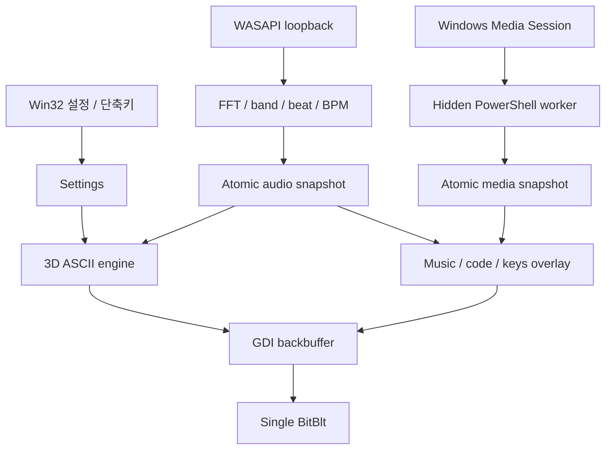

# 아키텍처

## 결정 및 트레이드오프

- Windows 실기에서 보고된 흐림/흔들림의 원인은 확정되지 않았다. v2.2에서는 렌더러 혼용보다 일관적인 GDI 경로를 우선한다. 원근 투영 및 회전은 CPU에서 계산하므로 3D 표현은 유지되나 GPU 셰이더 가속은 사용하지 않는다.
- UI는 Win32 이벤트 루프에서 처리한다. 오디오 캡처와 미디어 메타데이터 조회는 별도 워커와 원자적 스냅샷을 사용한다. 렌더링은 별도 스레드로 완전히 분리되지 않았다.
- 3D 씬의 글자와 오디오 스펙트럼을 같은 효과로 처리하지 않는다. GDI 발광은 제한된 배경 강조이며 셰이더 Bloom과 동일하지 않다.
- 미디어 세션과 오디오 캡처는 서로 다른 정보원이다. 시스템에서 여러 앱의 소리가 동시에 재생되면 현재 미디어 세션의 곡 정보와 분석 음원이 반드시 일치하지 않는다. 보호 콘텐츠의 캡처가 제한될 수 있다.
- 미디어 조회는 3초 주기의 숨겨진 PowerShell 프로세스에서 수행하며 실패 시 정보 없음으로 표시한다. 앨범 커버 조회가 추가 지연될 수 있다. 실제 오디오 반응은 별도 캡처 경로로 계속 진행된다.
- DirectX 11/Direct2D/DirectWrite 전환, GPU 셰이더, 완전한 렌더 스레드 분리, 가변 DPI 레이아웃, 클릭 가능한 음악 제어, 사용자 단축키 편집, 라이브 월페이퍼는 후속 개발 항목이다.
